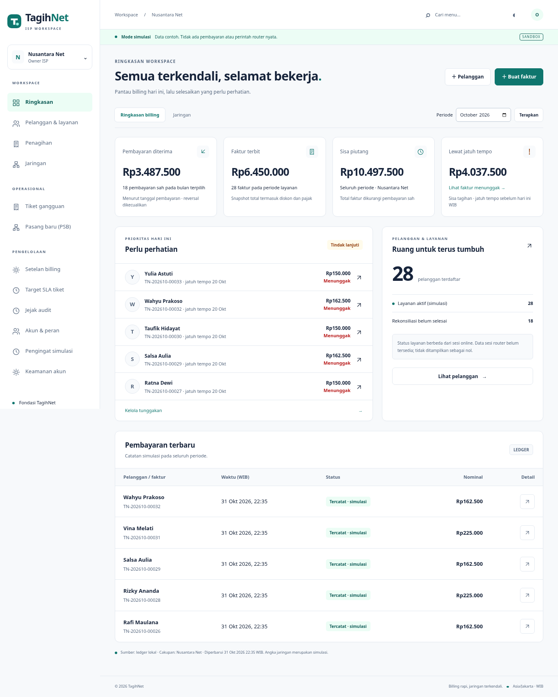

# TagihNet

**Billing rapi, jaringan terkendali.** Fondasi aplikasi billing ISP dengan backend nyata, data fiktif, dan integrasi simulasi.



Proyek baru ini dibangun dari [brief pengguna](docs/PRODUCT-BRIEF.md). Repositori awal tidak memiliki commit atau branch `main`. Fondasi berada di `feature/tagihnet-foundation`; checkpoint `feature/tagihnet-access-security` menambahkan MFA/editor akses; `feature/tagihnet-bulk-billing` menambahkan penerbitan massal, dan `feature/tagihnet-operations` menambahkan tiket/PSB dengan scope teknisi. Checkpoint `feature/tagihnet-reminders-rescheduling` menambah edit/jadwal ulang PSB dan pengingat simulasi opt-in. Cakupan brief belum seluruhnya selesai dan aplikasi belum siap produksi. Tidak dilakukan audit backend, pengambilan aset, atau perubahan pada KelolaNet.

## Yang bisa digunakan

- Login/logout, pemulihan akun lokal, rate limit persisten, timeout idle 30 menit dan absolut 8 jam.
- Dua ISP fiktif dengan pembatasan tenant dari akun yang terautentikasi; preset owner, operasional, keuangan, kasir, NOC, dan pelanggan.
- MFA wajib untuk operator: QR TOTP lokal, secret terenkripsi, kode pemulihan sekali pakai, pencegahan replay, dan verifikasi ulang aksi sensitif.
- Editor akun/peran kustom untuk owner, perlindungan pemilik terakhir, pembatasan tenant, dan pencabutan sesi saat akses berubah.
- Dashboard yang menghitung data dari ledger, disertai definisi metrik, periode, cakupan, serta waktu pembaruan WIB.
- Cari/filter/sort pelanggan, pagination server-side 10/25/50 yang tersimpan di URL, tambah/ubah/detail, dan ekspor CSV berizin.
- Satu layanan/paket per pelanggan; faktur bulanan idempoten, snapshot harga/pajak, diskon, pembayaran sebagian, penolakan lebih bayar, dan reversal penuh dengan histori.
- Faktur massal: pratinjau maksimal 500 pelanggan, MFA konfirmasi, snapshot disetujui, worker resumable, duplikat dilewati, serta pembatalan sisa pekerjaan.
- Detail faktur, cetak/PDF A4 multipage dengan footer teks aman, serta portal untuk faktur milik pelanggan sendiri.
- Antrean rekonsiliasi jaringan **simulasi** dengan pengecekan ulang tunggakan, backoff, dan maksimal tiga percobaan. Pembayaran tetap tercatat bila adapter gagal.
- Tiket gangguan/portal, prioritas/kategori/SLA snapshot, komentar publik/internal, penugasan dan timeline.
- PSB prospek → terpasang → aktivasi berizin/MFA, satu pelanggan/faktur awal/provisioning job, dengan status jaringan terpisah.
- Edit identitas/paket PSB sebelum Pengerjaan serta jadwal ulang beralasan, dengan versi dan riwayat sebelum/sesudah.
- Pengingat billing/SLA opt-in: antrean simulasi, deduplikasi persisten, retry terbatas, serta pemeriksaan ulang kondisi dan izin.
- Preset Teknisi dengan akses hanya pada pekerjaan yang ditugaskan, tanpa daftar pelanggan atau nominal billing.
- Mode terang/gelap, navigasi mobile, fallback peta eksternal, dan jejak audit.

[FEATURE-MATRIX](docs/FEATURE-MATRIX.md) merinci fungsi yang selesai, terbatas, dan belum dibuat. Gateway pembayaran, MikroTik/RADIUS nyata, scope wilayah geografis, lampiran/kanal notifikasi nyata, hotspot, payroll, dan migrasi produksi belum tersedia. Tidak ada menu palsu untuk modul tersebut.

## Stack dan struktur

Python 3.12+, Django **5.2 LTS**, SQLite untuk satu mesin pengembangan, template HTML/CSS/JavaScript tanpa build frontend, dan ReportLab untuk PDF. Django dipilih karena autentikasi, ORM, migrasi, validasi, dan CSRF bawaannya. PDF digambar dari teks lokal; tidak memakai browser atau mengambil URL eksternal.

```text
config/                  pengaturan, URL, WSGI
core/models.py           tenant, pelanggan, faktur, ledger, audit, antrean
core/billing.py          transaksi domain dan hitungan integer rupiah
core/bulk_billing.py     preview, persetujuan snapshot, worker massal per baris
core/operations.py       tiket, scope penugasan, SLA, PSB dan aktivasi atomik
core/reminders.py        kebijakan opt-in, planner/outbox pengingat tanpa pengiriman
core/network.py          adapter simulasi dan rekonsiliasi
core/permissions.py      izin deny-by-default
core/security.py         MFA, enkripsi, recovery, limiter atomic
core/access.py           editor role/akun dan perlindungan owner terakhir
core/management/commands worker dan seed lokal
core/tests/              pengujian domain, HTTP, izin, concurrency
templates/, static/      antarmuka orisinal TagihNet
scripts/                 smoke browser, PDF, backup/restore
docs/                    cakupan, audit, pengujian, operasional
data/                    database/kunci/email lokal; diabaikan Git
```

## Menjalankan lokal — Linux/macOS/cloud

Gunakan checkout yang ada; lingkungan cloud sudah terisolasi dan tidak memerlukan Git worktree baru.

```bash
cd /workspace/TagihNet       # atau direktori clone Anda
python3 -m venv .venv
source .venv/bin/activate
python -m pip install -r requirements.txt
python manage.py migrate --noinput
python manage.py seed_demo
python manage.py runserver 127.0.0.1:8000 --noreload
```

`seed_demo` membuat kata sandi acak dan menampilkannya sekali untuk akun baru. Untuk kata sandi lokal yang Anda pilih sendiri (minimal 12 karakter), set `TAGIHNET_DEMO_PASSWORD` sebelum seed. Seed ditolak saat `DEBUG=0` atau `SIMULATION=0`; pengulangan tidak mereset kata sandi maupun menimpa data yang sudah ada. Tidak ada kata sandi produksi bawaan.

Akun seed: `owner`, `owner2` (ISP kedua), `keuangan`, `kasir`, `noc`, `pelanggan`. Semua akun baru memakai kata sandi seed pada eksekusi tersebut. Dalam instance cloud yang disiapkan pada 31 Oktober 2026, kata sandi **khusus lokal** adalah `TagihNet-Lokal-2026!`. Jangan gunakan akun/kata sandi ini untuk deployment publik.

Login pertama operator sekarang meminta pendaftaran MFA. Pindai QR dengan authenticator, verifikasi kode, dan simpan sepuluh kode pemulihan. Tidak ada perangkat MFA bawaan. Pelanggan portal dapat mengaktifkan MFA secara sukarela. Sesi sebelum checkpoint akses akan diminta login ulang. Panduan lengkap: [AUTHENTICATION](docs/AUTHENTICATION.md).

Jalankan worker di terminal kedua:

```bash
source .venv/bin/activate
python manage.py run_simulation_worker          # loop; Ctrl+C untuk berhenti
# atau satu batch:
python manage.py run_simulation_worker --once
```

Jalankan worker billing di terminal terpisah untuk batch yang dikonfirmasi:

```bash
python manage.py run_billing_worker
# atau satu putaran, maksimal 100 baris per batch secara default:
python manage.py run_billing_worker --once --limit 100
```

Alur lengkap dan aturan stale/expiry, snapshot, izin, serta pembatalan ada di [BULK-BILLING](docs/BULK-BILLING.md). Preset Owner mendapat izin massal; operator lain memerlukan peran kustom dengan `bulk_issue`.

Gunakan URL lokal hanya saat menjalankan sendiri; lingkungan onboarding tidak menyediakan preview web publik.

## Windows PowerShell

```powershell
py -3.12 -m venv .venv
.\.venv\Scripts\python.exe -m pip install -r requirements.txt
.\.venv\Scripts\python.exe manage.py migrate --noinput
.\.venv\Scripts\python.exe manage.py seed_demo
.\.venv\Scripts\python.exe manage.py runserver 127.0.0.1:8000 --noreload
```

## Docker Desktop — konfigurasi pengembangan

```bash
docker compose up --build -d
docker compose exec web python manage.py seed_demo
docker compose exec web python manage.py run_simulation_worker --once
docker compose exec web python manage.py run_billing_worker --once
docker compose down
```

Volume `tagihnet-data` mempertahankan database. `docker compose down -v` menghapusnya; jangan gunakan bila ingin menyimpan data. Image berjalan sebagai user non-root; port hanya diikat ke localhost. Dockerfile dan konfigurasi Windows disediakan, tetapi belum dieksekusi pada checkpoint Linux ini.

## Pengingat simulasi

Owner dapat membuka **Pengingat simulasi**, meninjau dan menyimpan kebijakan dengan MFA terbaru. Billing dan SLA nonaktif secara bawaan. Jalankan proses keempat secara terpisah:

```bash
python manage.py run_reminder_worker
# atau satu putaran:
python manage.py run_reminder_worker --once --limit 100
```

Tidak ada WhatsApp/email yang dikirim. Billing satu per faktur/hari WIB; SLA satu per deadline dan siklus penanganan. Worker memeriksa ulang pelunasan/resolusi/izin. Panduan: [REMINDERS-AND-RESCHEDULING](docs/REMINDERS-AND-RESCHEDULING.md).

## Pengujian

```bash
python manage.py check
python manage.py makemigrations --check --dry-run
python -m pip check
python manage.py test --verbosity 2
python -m pip install -r requirements-dev.txt
python scripts/verify_pdf.py
python scripts/verify_restore.py
python scripts/security_smoke.py
python scripts/operations_smoke.py
```

`security_smoke.py` menjalankan server/database sementara, menguji enrollment MFA/peran/revocation/recovery, penerbitan massal/worker/resume/duplikat/pembatalan, lalu alur billing browser lengkap. Restore drill SQL juga memeriksa antrean batch parsial. Akun demo pengguna tidak diubah; direktori sementara dihapus setelah selesai. Chromium diperlukan. Bukti visual tidak merekam QR, secret, atau kode pemulihan.

Untuk uji browser terhadap instance development yang sedang berjalan, daftarkan MFA owner terlebih dahulu dan gunakan kata sandi serta OTP baru/kode pemulihan aktual. Skrip menolak host non-lokal, menambahkan satu pelanggan uji berlabel `Uji Browser`, dan melakukan transaksi **simulasi**. Bukti visual disimpan di `docs/evidence/`.

```bash
export TAGIHNET_DEMO_PASSWORD='kata-sandi-seed-lokal-Anda'
export TAGIHNET_MFA_CODE='kode-OTP-baru-atau-kode-pemulihan-sekali-pakai'
export CHROMIUM_PATH=/usr/bin/chromium   # sesuaikan lokasi executable
python scripts/browser_smoke.py
```

[TEST-REPORT](docs/TEST-REPORT.md) memuat hasil yang benar-benar dijalankan. Backend serta browser MFA/billing dan operasional terisolasi didaftarkan pada GitHub Actions; PDF/restore juga dapat dijalankan mandiri. Keberhasilan CI remote belum dikonfirmasi.

## Konfigurasi dan troubleshooting

Variabel tersedia di [.env.example](.env.example). Aplikasi membaca **environment process**, tidak otomatis memuat file `.env`. Secret lokal acak disimpan dengan mode 0600 di `data/.secret_key` dan `data/.mfa_key`. Produksi wajib menyediakan `TAGIHNET_SECRET_KEY` dan `TAGIHNET_MFA_KEY` yang berbeda dan dikelola terpisah dari database. Jangan commit database, email reset, backup, atau kunci.

- **Login ditolak setelah percobaan berulang:** tunggu 15 menit; batas awal lima percobaan per identitas/IP, termasuk percobaan sukses. Jangan menonaktifkan rate limit untuk deployment.
- **Kata sandi seed berbeda:** menjalankan seed ulang tidak mengubah kata sandi. Gunakan `python manage.py changepassword owner` secara lokal.
- **Status pembayaran lunas tetapi layanan belum aktif:** jalankan worker; lihat antrean/gagal. Data seed memiliki satu router simulasi sengaja tidak terjangkau.
- **Batch menunggu worker:** jalankan `run_billing_worker`. Batch stale/expired/blocked perlu ditinjau lewat pratinjau baru; jangan mengubah snapshot/status langsung di database.
- **Pengingat kosong/tertahan:** pastikan kebijakan opt-in dan worker aktif; perubahan izin pemberi persetujuan memerlukan simpan ulang dengan MFA terbaru. Gagal tiga kali tetap terminal untuk kunci deduplikasi tersebut.
- **Database busy:** ulangi request dengan kunci idempotensi yang sama. SQLite untuk pengembangan; uji PostgreSQL serta lock/queue terdistribusi sebelum skala produksi.
- **Email reset tidak terkirim:** pada development, lihat file privat di `data/emails/`. SMTP/TLS harus dikonfigurasi dan diuji untuk deployment.
- **Sesi online tidak ada:** adapter monitoring nyata belum dibuat; UI sengaja menampilkan “belum tersedia”.

Lihat [OPERATIONS](docs/OPERATIONS.md), [SECURITY-AUDIT](docs/SECURITY-AUDIT.md), [ASVS-CHECKLIST](docs/ASVS-CHECKLIST.md), [PERMISSIONS](docs/PERMISSIONS.md), dan [UX-AUDIT](docs/UX-AUDIT.md) sebelum melanjutkan implementasi atau deployment.

## Tiket, teknisi, dan PSB

Buka menu **Tiket gangguan** atau **Pasang baru (PSB)**. Owner/Admin operasional mengelola pekerjaan; buat akun preset Teknisi melalui Akun & peran sebelum menugaskan. Teknisi wajib MFA dan hanya melihat tugas sendiri. Pelanggan portal dapat membuat/mengomentari tiketnya; catatan internal tidak ditampilkan.

PSB tidak membuat pelanggan/faktur sampai tahap Terpasang dan aktivasi disetujui akun berizin dengan MFA terbaru. Status customer awal Menunggu provisioning; invoice belum otomatis lunas dan router nyata tidak diubah. `operations_smoke.py` menguji alur pada server/database sementara tanpa mengubah akun/data demo pengguna. Panduan lengkap dan batas SLA, lampiran serta integrasi: [SUPPORT-AND-INSTALLATIONS](docs/SUPPORT-AND-INSTALLATIONS.md).
