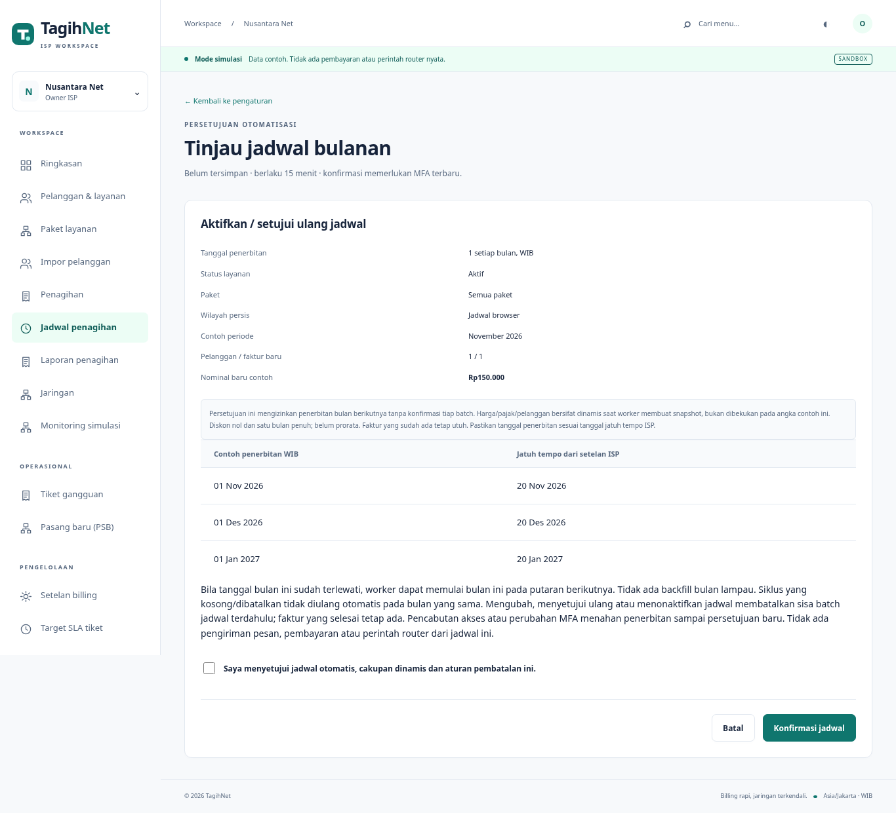
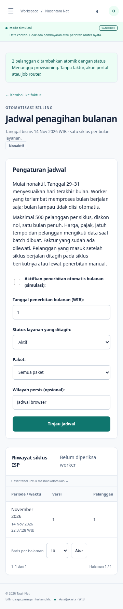

# Jadwal penagihan bulanan

Owner membuka **Penagihan → Jadwal bulanan** atau menu **Jadwal penagihan**. Default nonaktif; membuka halaman tidak membuat konfigurasi atau faktur. Pilih aktif/nonaktif, tanggal 1–31, status layanan, paket dan wilayah persis. **Tinjau jadwal** menampilkan contoh jumlah/nominal, tiga tanggal penerbitan/jatuh tempo dan dampak perubahan. Centang persetujuan lalu **Konfirmasi jadwal** dengan MFA terverifikasi dalam lima menit terakhir. Pratinjau bertanda tangan berlaku 15 menit dan terikat akun, tenant serta versi akses.

Persetujuan mengizinkan penerbitan bulan berikutnya tanpa konfirmasi setiap batch. Jumlah pelanggan, paket/harga, pajak, jatuh tempo dan footer mengikuti data saat worker membuat batch. Angka contoh pada review bukan pembekuan tagihan masa depan. Data contoh diperiksa ulang saat konfirmasi; perubahan harga/pelanggan/faktur, konfigurasi bersaing, pergantian bulan atau izin yang berubah mengharuskan review baru.

## Aturan tanggal dan nominal

- Satu siklus untuk satu ISP dan satu bulan layanan, berdasarkan tanggal **Asia/Jakarta/WIB**. Periode tersimpan pada hari pertama bulan.
- Tanggal 29–31 memakai hari terakhir bulan jika lebih pendek, termasuk Februari kabisat. Misalnya tanggal31 menjadi28 Februari2026,29 Februari2028 dan30 April.
- Worker memulai jika tanggal bisnis sudah mencapai jadwal. Bila terhenti beberapa hari, hanya bulan yang sedang berjalan diproses. Bulan lampau tidak diisi otomatis.
- Saat jadwal diaktifkan setelah tanggal bulan ini, siklus dapat dimulai pada putaran worker berikutnya. Bila bulan ini sudah memiliki siklus, contoh review berpindah ke bulan berikutnya.
- Jatuh tempo mengikuti setelan ISP pada bulan layanan yang sama. Bila jadwal/eksekusi melewati jatuh tempo, faktur dapat langsung menunggak; tidak ada penggeseran jatuh tempo otomatis.
- Tagihan satu bulan penuh, diskon nol dan pajak integer sesuai aturan billing yang sudah ada. Prorata, prabayar/pascabayar khusus dan tanggal per pelanggan belum ditambahkan.
- Maksimal500 pelanggan per siklus. Cakupan terlalu besar atau harga/filter tidak valid menahan jadwal tanpa batch/penagihan sebagian. Persempit filter atau perbaiki data, lalu tinjau ulang.
- Status default **Aktif**. **Semua layanan** juga memasukkan pelanggan pending; pilihan ini dijelaskan di formulir. Filter paket selalu dibatasi ISP sendiri, wilayah menggunakan kecocokan persis.

Batch membuat snapshot pelanggan/harga/setelan tepat saat generasi. Setelah itu harga baru tidak mengubah snapshot yang sudah diantrekan. Faktur yang sudah ada untuk pelanggan/periode dilewati tanpa perubahan. Pelanggan yang masuk setelah siklus dibuat ditangani pada bulan berikutnya atau penerbitan manual terpisah. Siklus kosong dicatat tanpa batch. Siklus kosong/dibatalkan tetap dianggap sudah berjalan untuk bulan itu dan tidak dibuat ulang otomatis.

## Worker, pembatalan dan akses

Tidak ada worker baru. Perintah yang sama kini memeriksa maksimal10 jadwal aktif setiap putaran, secara bergiliran dari pemeriksaan terlama, kemudian memproses batch:

```bash
.venv/bin/python manage.py run_billing_worker
.venv/bin/python manage.py run_billing_worker --once
```

Satu transaksi mengunci tenant dan jadwal, membuat siklus unik/batch/items/audit atomik. Batch diproses satu baris per transaksi oleh worker lama, sehingga restart mempertahankan progres. Dua scheduler serentak tidak menggandakan siklus, dua worker tidak menggandakan faktur. Penerbitan manual bersamaan tetap menggunakan constraint pelanggan/periode dan pengunci pelanggan yang sama.

Mengubah, menyetujui ulang atau menonaktifkan jadwal membatalkan sisa batch jadwal sebelumnya. Faktur yang telah selesai tetap ada; baris yang sedang diproses dapat selesai sebelum konfirmasi perubahan selesai. Penonaktifan tidak membatalkan batch manual. Tidak ada tombol melanjutkan siklus otomatis yang dibatalkan; bila perlu, gunakan preview manual baru untuk faktur yang belum ada.

Setiap generasi dan setiap baris memeriksa ulang user aktif, tenant, capability, versi akses dan revisi perangkat MFA pemberi persetujuan. Pencabutan akses/perubahan MFA menahan pekerjaan berikutnya. Persetujuan tidak pulih otomatis saat izin dikembalikan; owner berwenang perlu meninjau dan menyetujui ulang. Batch yang ditahan tidak diteruskan oleh worker sampai ada tindakan baru yang sah. Penghapusan konfigurasi/histori tidak tersedia.

Capability baru `manage_billing_schedule` dimiliki owner secara default. Peran kustom memerlukan juga `bulk_issue`, `issue`, `invoices` dan `customers`. Preset operasional/keuangan/kasir/NOC/teknisi/pelanggan tidak otomatis mendapatkannya. Endpoint `/invoices/schedule/` serta POST `/invoices/schedule/confirm/` menegakkan izin backend, CSRF dan tenant dari membership. Tidak ada parameter tenant bebas. Jadwal/riwayat dapat dibaca pengelola jadwal ISP; rincian batch tetap privat bagi pembuatnya. Batch milik pengelola lain tidak menjadi dapat dibaca lewat tautan riwayat.

Jadwal ini **hanya simulasi**. SIMULATION=0 menolak pengaktifan, tidak membuat siklus dan menahan baris batch otomatis yang sudah antre. Batch manual mempertahankan kontrak sebelumnya. Tidak ada pembayaran, pengiriman notifikasi atau job router yang dibuat jadwal. Reminders/provisioning tetap alur terpisah. Tidak ada klaim scheduler produksi, jam eksekusi presisi, backfill atau kapasitas di atas batas tersebut.

## Migrasi dan verifikasi

Migrasi0011 menambah `BillingSchedule` dan `BillingScheduleRun`, tanpa konversi ledger atau pengaktifan konfigurasi. Ada constraint tanggal1–31, satu jadwal/tenant dan satu siklus/jadwal/bulan. Semua relasi histori memakai PROTECT.

Pada14 November2026, empat proses development dihentikan, backup schema0010 terenkripsi dibuat/dibaca ulang, lalu restore sementara bermigrasi ke0011 dan dibandingkan per baris. Hanya setelah semua baris lama cocok, migrasi database lokal diterapkan dengan `set -e`. Semua baris aplikasi/auth lama tetap sama, hanya dua tabel kosong dan delapan permission baru. PostgreSQL lab ikut bermigrasi. Archive schema0011 baru diverifikasi/restore dengan semua digest aplikasi/auth cocok; kunci/arsip lama dipertahankan. Default demo tetap30 pelanggan/37 faktur/19 pembayaran, tanpa jadwal/MFA/foto/NAS baru.

31 tes jadwal menambah total menjadi444 pada SQLite dan444 PostgreSQL. Dua skenario proses baru menambah total menjadi17: scheduler ganda menghasilkan satu siklus/batch, worker ganda menghasilkan satu faktur per pelanggan/periode. Dump/restore biasa dan terenkripsi PG mencakup jadwal, run, snapshot batch, ledger, MFA dan20 foto. Drill encrypted SQLite juga mencakup konfigurasi/siklus antre nonkosong serta autentikasi/foto sesudah restore. Browser sementara menguji review tanpa efek, konfirmasi, worker/restart, satu faktur/siklus, nonaktif, scope serta360/768/1366/1920px; restore SQLite membandingkan kedua tabel baru. Tidak ada fixture pada data pengguna.

```bash
.venv/bin/python manage.py test core.tests.test_billing_scheduler --noinput
.venv/bin/python scripts/operations_smoke.py
.venv/bin/python scripts/postgres_lab.py run scripts/verify_postgres.py
.venv/bin/python scripts/verify_encrypted_backup.py
```




