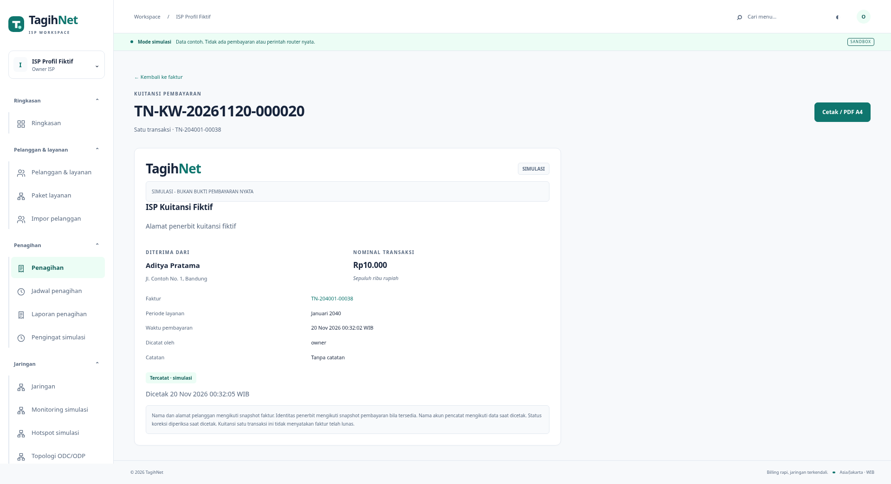
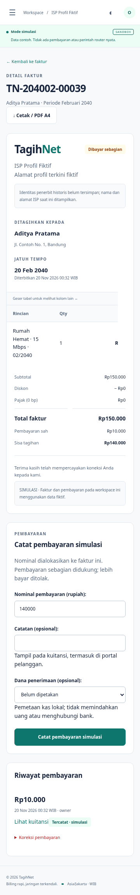

# Identitas penerbit dokumen — 20 November 2026 WIB

Faktur baru menyimpan nama dan alamat ISP saat diterbitkan. Pembayaran baru menyimpan kedua field secara terpisah saat dicatat. HTML dan PDF cetak ulang memakai identitas yang tersimpan pada dokumennya masing-masing, termasuk kuitansi transaksi yang kemudian direversal.

Contoh: faktur diterbitkan ketika nama ISP **A**, pembayaran dicatat setelah nama menjadi **B**, lalu profil diubah menjadi **C**. Faktur tetap menampilkan **A**, kuitansi menampilkan **B**, dan profil workspace menampilkan **C**. Nama akun pencatat dan status koreksi tetap dibaca saat cetak ulang; seluruh dokumen belum merupakan salinan penerbitan yang dibekukan atau ditandatangani secara digital.

Dokumen lama tanpa snapshot memakai nama/alamat ISP saat ini dengan penjelasan **“Identitas penerbit historis belum tersimpan; nama dan alamat ISP saat ini ditampilkan.”** Identitas masa lalu tidak dapat disimpulkan dari profil terkini. Migrasi, membuka halaman, mencetak, replay faktur atau replay pembayaran tidak mengisi riwayat tersebut.

## Transaksi dan batch

Schema `0015_document_issuers` hanya menambah dua tabel dengan relasi satu-ke-satu yang dilindungi: `InvoiceIssuerSnapshot` dan `PaymentIssuerSnapshot`. Setiap snapshot memuat nama, alamat, dan waktu pembuatan dokumen. Tenant berasal dari faktur/pembayaran yang sudah diperiksa, tanpa input tenant baru dari request. Tidak ada endpoint untuk mengubah snapshot.

Penulisan snapshot berada dalam transaksi dokumen, baris rincian, job dan audit yang sama. Kegagalan snapshot atau audit membatalkan seluruh penulisan. Replay memakai dokumen yang sudah ada tanpa mengganti identitas atau membuat snapshot pada dokumen lama. Reversal mempertahankan identitas pembayaran asli.

Semua jalur penerbitan memakai writer yang sama: faktur satuan, batch yang disetujui, scheduler, dan aktivasi PSB. **Identitas penerbit diambil saat penerbitan aktual**, dengan pembacaan baru dari database. Snapshot nominal/pajak/footer/jatuh tempo batch yang sudah disetujui tetap berlaku. Persetujuan lama tidak ditulis ulang atau dibatalkan hanya untuk mengisi identitas penerbit.

## Migrasi dan pemulihan

Tidak ada backfill atau perubahan kolom/baris bisnis lama. Pada database yang dipertahankan, kedua tabel baru harus kosong tepat setelah migrasi. Rekonsiliasi memeriksa hash setiap baris lama, urutan/isi kolom, sequence dan metadata Django: tepat dua content type, delapan permission, satu migration recorder. SQLite dan PostgreSQL memakai checker terpisah:

```bash
.venv/bin/python manage.py test core.tests.test_document_issuers core.tests.test_receipts core.tests.test_concurrency --noinput
.venv/bin/python scripts/document_issuer_smoke.py
.venv/bin/python scripts/verify_receipt.py
.venv/bin/python scripts/verify_encrypted_backup.py
.venv/bin/python scripts/verify_staging_backup.py
```

Checker migrasi memerlukan baseline privat yang dibuat sebelum upgrade; `scripts/document_issuer_migration_check.py` membaca SQLite secara read-only, sedangkan `scripts/document_issuer_pg.py` merekonsiliasi PostgreSQL. Backup lama schema0014 tetap dipertahankan dan hanya dipulihkan ke target baru, kemudian dimigrasikan. Mengembalikan image0014 pada database0015 bukan prosedur rollback yang disetujui.

Pengujian browser membuat database/server/MFA fiktif sementara dan menghapusnya setelah selesai. Bukti visual berikut tidak berisi faktor autentikasi atau data pengguna persisten:





Hasil suite, migrasi, backup dan rollout lokal dicatat di [TEST-REPORT](TEST-REPORT.md). Pembayaran tetap simulasi; legalitas pajak, tanda tangan digital, gateway, provisioning router, SMTP, offsite dan deployment VPS tetap memerlukan pekerjaan terpisah.
