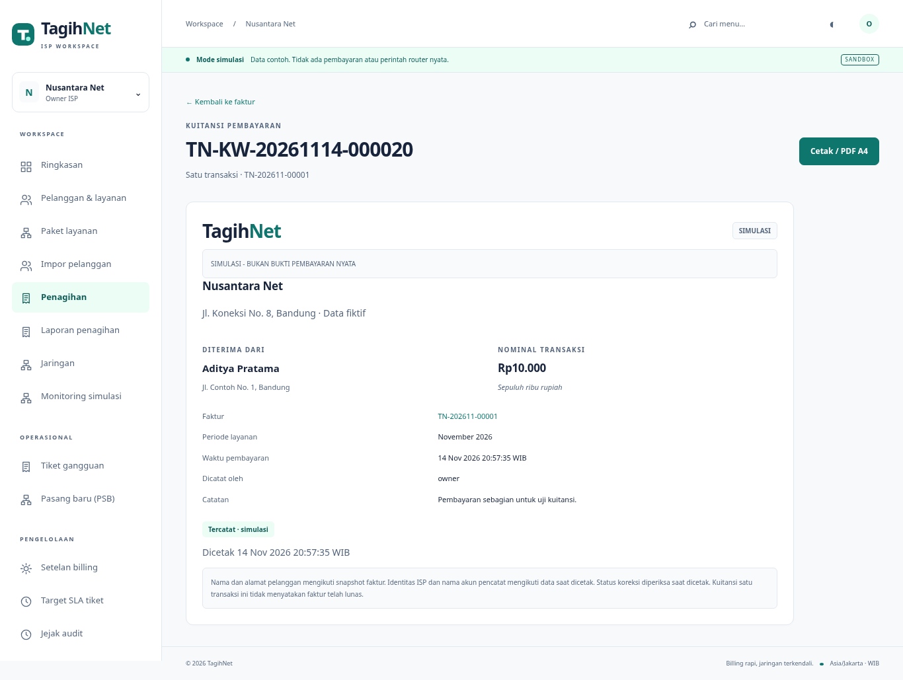
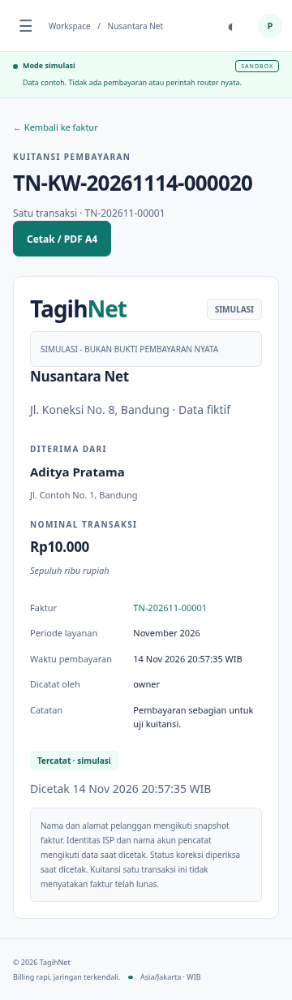

# Kuitansi pembayaran

Pada detail faktur, setiap pembayaran memiliki tautan **Lihat kuitansi**, termasuk transaksi yang sudah direversal. Operator yang dapat membuka tab Pembayaran pada detail pelanggan juga menemukan tautan di sana. Pelanggan masuk melalui faktur miliknya di portal. Halaman kuitansi menyediakan **Cetak / PDF A4**; gunakan perintah cetak pembaca PDF.

Satu kuitansi mewakili satu pembayaran, termasuk pembayaran sebagian. Nomor `TN-KW-YYYYMMDD-ID` berasal dari tanggal transaksi WIB dan ID pembayaran, berbeda dari nomor faktur. Membuka atau mencetak ulang tidak menerbitkan transaksi, mengubah saldo, menambah audit bisnis atau membuat job. Tidak ada tabel, migrasi, worker atau dependensi runtime baru.

Kuitansi memuat nominal asli, terbilang integer rupiah, tanggal pembayaran WIB hingga detik, nomor/periode faktur, pelanggan, pencatat dan catatan pembayaran. Form pembayaran menjelaskan bahwa catatan tampil pada kuitansi dan portal; jangan masukkan catatan internal ke field ini. Nominal kuitansi tidak digabung dengan pembayaran lain dan tidak menyatakan faktur lunas. Buka faktur untuk saldo terbaru.

Nama/alamat pelanggan menggunakan snapshot faktur. Nama/alamat ISP dan username pencatat menggunakan data akun saat dicetak karena model sebelumnya tidak menyimpan snapshot penerbit/pencatat. Waktu cetak ditampilkan. Dokumen ini merupakan tampilan ledger terkini, bukan salinan penerbitan yang dibekukan, kuitansi fiskal bertanda tangan atau sarana verifikasi publik.

Reversal mempertahankan nominal, nomor dan waktu pembayaran asli. Cetak ulang menampilkan **Direversal · transaksi tidak berlaku**, waktu/pencatat/alasan koreksi. PDF menandai reversal pada halaman pertama dan footer setiap halaman. Salinan PDF yang sudah disimpan atau dicetak sebelumnya tidak dapat diperbarui otomatis. Cek ulang lewat aplikasi untuk status terkini.

Semua pembayaran pada aplikasi ini berasal dari pencatatan simulasi. Label **SIMULASI - BUKAN BUKTI PEMBAYARAN NYATA** selalu ada, termasuk jika konfigurasi SIMULATION kemudian dinonaktifkan. Tidak ada integrasi gateway, settlement bank, tanda tangan/QR verifikasi atau pengiriman kuitansi ke pihak lain.

## Akses dan rendering

Endpoint GET:

```text
/invoices/<invoice_id>/payments/<payment_id>/receipt/
/invoices/<invoice_id>/payments/<payment_id>/receipt.pdf
```

Izin mengikuti `allowed_invoice`: owner, operasional, keuangan dan kasir pada ISP sendiri; peran kustom memerlukan `invoices`. Portal hanya pelanggan yang tertaut pada faktur. NOC/teknisi ditolak. Payment wajib cocok dengan tenant dan faktur pada URL. Pergantian ID faktur/pembayaran tidak memperluas akses. Login, MFA operator, masa sesi, versi akses dan pencabutan akun tetap berlaku. Tautan bukan token akses publik.

Respons privat/no-store dan nosniff. HTML memakai autoescape; ReportLab menggambar teks yang di-escape, tanpa interpretasi gambar/URL dari input. Font Latin Vera yang sudah termasuk paket ReportLab disematkan, sehingga PDF tidak memerlukan font sistem atau unduhan. Teks panjang dipaginasi pada A4, dengan nomor halaman. Tidak ada aset dari URL pengguna.

## Verifikasi

31 tes kuitansi/terbilang mencakup peran, tenant/ID swap, portal sendiri/pelanggan lain, sesi dicabut/user nonaktif, GET-only, tanpa mutasi ledger, pembayaran sebagian, nomor stabil/tanggal WIB, snapshot pelanggan, penerbit terkini, reversal, label simulasi tetap, cache, XSS/markup, judul/ukuran PDF, font tertanam/aksen Latin dan teks panjang. Suite penuh: 413 tes per backend, SQLite dan PostgreSQL.

Untuk pengujian backend, pasang `requirements-test.txt`; `requirements-dev.txt` menyertakannya. PostgreSQL juga memerlukan `requirements-postgres.txt`. Runtime tetap menggunakan `requirements.txt`. CI diperbarui agar pembaca PDF hanya menjadi dependensi tes; hasil CI remote belum diverifikasi.

```bash
.venv/bin/python manage.py test core.tests.test_receipts --noinput
.venv/bin/python scripts/verify_receipt.py
.venv/bin/python scripts/operations_smoke.py
```

Verifier PDF standalone tidak mengakses database dan menulis fixture fiktif ke `data/evidence/receipt-payment.pdf` (satu halaman) serta `receipt-reversed-multipage.pdf` (empat halaman). Teks, nominal, waktu, terbilang, marker akhir field, A4 dan footer diperiksa melalui pypdf. Browser memakai database/server sementara untuk alur pembayaran sebagian, operator/portal, PDF, reversal, penolakan scope dan 360/768/1366/1920 px; data demo persisten tidak diisi fixture.




