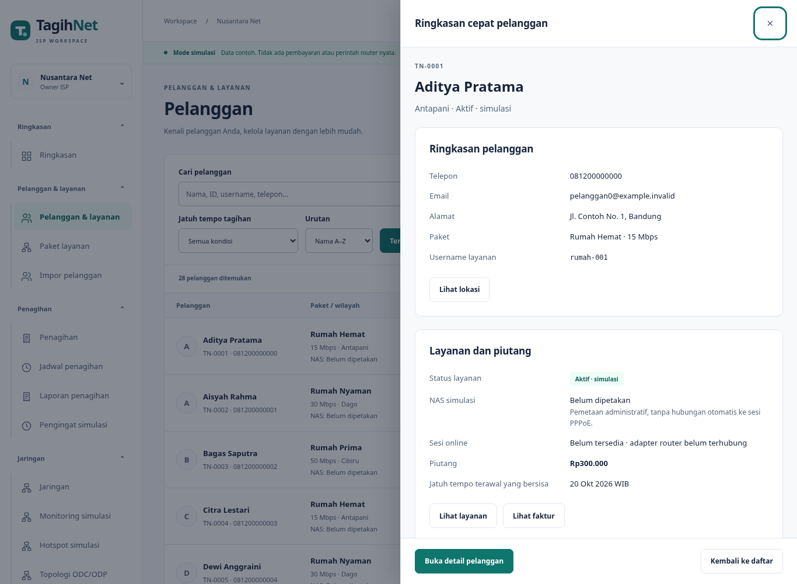
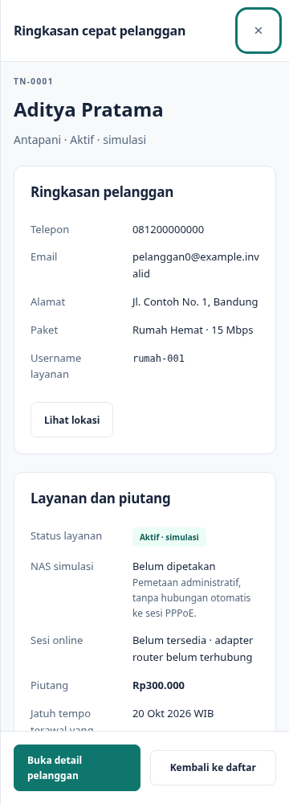

# Navigasi workspace dan drawer pelanggan

Branch `feature/tagihnet-workspace-navigation`. Schema tetap0014; tidak ada model,
migrasi, dependency atau aturan billing baru.

## Navigasi berdasarkan tugas

Sidebar dikelompokkan menjadi Ringkasan, Pelanggan & layanan, Penagihan, Jaringan,
Operasional, Keuangan & tim, Pemasaran, serta Pengaturan & akun. Kelompok kosong
tidak dirender. Semua link memakai izin server yang sama dengan tujuannya,
termasuk peran kustom dan cakupan khusus Teknisi/Sales/pelanggan.

Kelompok menggunakan `details/summary` native. Default terbuka, dapat dilipat
dengan mouse/Enter/Space, dan preferensi buka/tutup disimpan opsional di browser.
Grup halaman aktif dibuka saat navigasi. Browser storage hanya menyimpan boolean
ID grup, tanpa isi pelanggan, password, token atau data keuangan.

Pencarian cocok dengan label grup atau menu. Grup tertutup yang cocok dibuka
sementara; menghapus pencarian memulihkan status sebelum pencarian. Pesan hasil
dibacakan lewat status aksesibel. Di mobile pencarian berada dalam sidebar.
Menu mobile mengelola fokus, membatasi Tab di panel, membuat aplikasi di belakang
inert, serta menyediakan tombol tutup/Escape dan pengembalian fokus. Tanpa
JavaScript, navigasi native tetap tersedia dan kontrol pencarian yang tidak
berfungsi disembunyikan.

## Ringkasan cepat pelanggan

Dua aksi44px tetap terlihat pada kolom kanan tabel: ringkasan cepat dan detail
penuh. Ringkasan membuka dialog di sisi kanan, dengan header/footer tetap terlihat
dan area isi dapat digulir. Filter/urutan/halaman/scroll daftar dipertahankan.
Detail penuh dan link lokasi/layanan/faktur memakai URL pelanggan yang benar.

Dialog berlabel, mengelola fokus Tab/ShiftTab, mendukung Escape/backdrop/tombol,
dan mengembalikan fokus ke pemicu. Penutupan membatalkan fetch serta membersihkan
isi. Nomor generasi request mengabaikan respons lama; event close yang tertunda
tidak boleh membersihkan dialog yang baru dibuka.

Link pemicu tetap memiliki href detail penuh. Ctrl/Cmd/Shift dan browser tanpa
dukungan dialog/JavaScript mengikuti link biasa. Storage yang diblokir tidak
menghalangi penggunaan. Gagal jaringan/403/404/500 atau redirect sesi berakhir
menampilkan pesan umum dan link detail, tanpa memasukkan HTML login/error.

## Batas data dan keamanan

`GET /customers/<pk>/preview/` memerlukan `customers`, objek tenant saat ini dan
login/MFA operator yang berlaku. Tenant asing/missing404; POST405. Query string
tidak memilih tenant, tab atau pelanggan lain. Pelanggan portal, Teknisi, Sales,
NOC dan kasir tanpa capability pelanggan tidak memperoleh akses global melalui
drawer. Peran `customers` memang sudah mengizinkan piutang agregat pada daftar
dan ringkasan; izin baru tidak ditambahkan.

HTML partial hanya merender ringkasan pelanggan yang di-escape, tanpa catatan
pembayaran, nomor/riwayat faktur, token, payroll atau kredensial voucher. Link
faktur hanya bagi `invoices`. Header private/no-store/noindex berlaku. Fetch hanya
ke rute preview numerik pada origin yang sama; respons redirect/nonHTML/error
ditolak. Tidak ada payload pelanggan yang disimpan pada storage browser, dan GET
tidak membuat transaksi, job, audit perubahan atau mengonsumsi faktor MFA.

Ini peningkatan navigasi dan pembacaan. Hak akses/billing/saldo/paket/consent tetap
diatur endpoint/domain yang sudah ada. Ini bukan sertifikasi WCAG atau audit
keamanan independen.

## Verifikasi

10 tes baru mencakup kelompok berizin/current page, form action→modul, custom role,
preview tenant/role/parameter spoofing/escaping/cache/GET dan preservasi isi model.
781 tes SQLite serta781 PostgreSQL lulus. Uji browser nyata mencakup MFA pada
fixture terpisah, persistensi/pencarian/fokus, buka/tutup/backdrop/Escape, respons
terlambat/error/sesi berakhir, empat lebar360/768/1366/1920px, dark mode, storage
diblokir dan tanpa JavaScript. Ledger fixture tetap sama. Regresi browser keenam
modul bisnis juga lulus. Loop fokus eksplisit memperbaiki perilaku ShiftTab awal
yang meninggalkan dialog pada browser pengujian.

Gambar berikut memakai data **fiktif** dari database sementara, tanpa faktor MFA:

Hasil staging/backup, image, preservasi data/kunci, dan batas produksi dicatat pada
[TEST-REPORT](TEST-REPORT.md). Fitur tersisa tetap pada [FEATURE-MATRIX](FEATURE-MATRIX.md).
